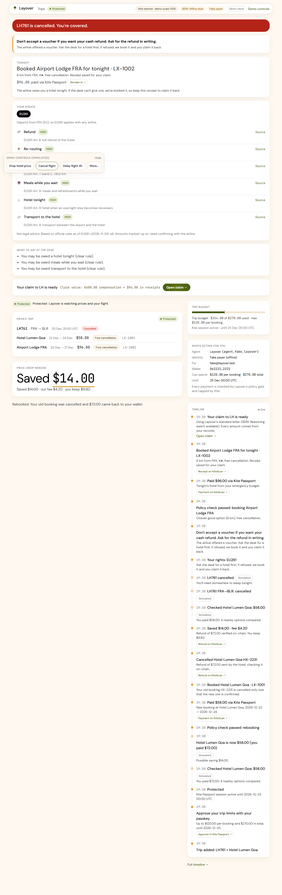

# Layover — your trip's guardian

**Layover saves you money before you fly and rescues you when the flight breaks.** You approve its spending limits once with your Kite Agent Passport; after that it watches your trip.



- **Dropwatch (before the trip):** watches your refundable hotel booking. When the price drops it **books the cheaper rate first**, then cancels the old one, **verifies the refund on-chain** and shows what you saved ("Saved $14.00 · our fee $4.20 · you keep $9.80").
- **Rescue (travel day):** when your flight is cancelled or badly delayed it works out your passenger rights (**EU261 / UK261, US DOT, India DGCA**), tells you **which airline offer not to accept** so you keep your cash refund, books a hotel near the airport from the emergency budget you approved, and drafts your claim with every receipt attached.

Built for **SERV Hackathon 02 — Kite track** (OpenServ × Kite AI): "agents that can shop, book and pay on your behalf, safely".

## 30-second pitch
Agents can book and pay now, but nobody watches your trip *after* you pay. Hotel prices drop after booking in a large share of cases and nobody re-checks; when a flight is cancelled at 11 p.m. travelers take the first voucher (which can forfeit a US DOT cash refund), don't know EU261 owes them a hotel and up to €600, and never file the claim. Layover does all three, inside limits you set once with a passkey.

## How it works
| Layer | What decides | Where |
|---|---|---|
| **Money** | A pure, table-tested **policy gate** (session active, per-tx and total caps, allowed merchant, same dates, room class, rating/distance, refundable, cancel window, minimum saving; for rescue: overnight, distance, rating, check-in night). | `services/core/src/policy/gate.ts` |
| **Entitlements** | A pure **rights engine** over JSON rule packs checked against the official texts (EUR-Lex, CAA, eCFR 14 CFR 260, DGCA CAR Rev 4). Amounts only ever come from the packs. | `services/core/src/rights/engine.ts`, `packages/shared/rules/` |
| **Language** | **SERV Reasoning** parses, explains and drafts, never decides. | `services/core/src/serv/` |
| **Payments** | **Kite Agent Passport** (`kpass`) — one passkey-approved session per trip. | `services/core/src/passport/` |

### SERV Reasoning call graph
Every call uses a system prompt, a strict `json_schema` response, zod validation, one retry with the validation errors, and logs only step/model/latency/outcome (no prompt text, no key).

| Step | Model | SERV tools | Input | Guard |
|---|---|---|---|---|
| TripIntake | `gpt-5.4-mini` | `serv_prompt_guard` | typed trip or pasted email in `<untrusted>` | extracts identifiers only; schedules and prices are looked up at the source |
| NoticeParse | `gpt-5.4-mini` | `serv_prompt_guard`, `serv_shadow_agent` | airline notice in `<untrusted>` | the rights engine never reads free text |
| RightsExplain | `gpt-5.4-mini-serv-kronos` | — | the engine's assessment | post-check: every number must exist in the assessment, else a deterministic explanation |
| OptionRank | `gpt-5.4-nano` | — | top 3 hotels (already ranked by code) | reasons only, never reorders |
| ClaimDraft | `claude-sonnet-5.5` (→ `gpt-5.4-mini`) | `serv_shadow_agent` | ClaimData built by code | post-check: every amount, tx hash and booking reference must exist in ClaimData; "up to" for VERIFY amounts; else a template letter |

### Kite Agent Passport usage
- **One session per trip**, approved with a passkey: per-tx cap = max per booking, total = emergency budget + max per booking, TTL = checkout + 24 h (`kpass session create --delegation … --separate`).
- Every booking is an **x402 payment** through `kpass session execute --idempotency-key …` to the merchant's `POST /v1/book/<tier>` (verify → book → settle only on success).
- Cap, scope or expiry errors stop the action and ask for a new session; Layover **never retries on the same session**.
- Refunds are verified on Kite chain by decoding the ERC-20 `Transfer` in the refund transaction (exact token, sender, recipient, amount).
- Demo scale 1:100 on **Kite testnet** (display $72 → settles 0.72 pieUSD).

## What is proven
Real transactions on Kite testnet are listed in **[docs/PROVEN.md](docs/PROVEN.md)** (Act 1 payment, Act 1 refund, Act 2 payment).

> Status: the code path is complete and tested end-to-end offline (201 unit tests + 6 Playwright/axe tests in CI). The live runs need the owner's Kite Passport login and SERV API key; their tx links are added to PROVEN.md as soon as they run.

## What is mocked
- **Hotels and flight status** are a mock merchant and mock feed (`services/mocks`), controlled by the demo panel. Every demo trigger is labeled **Simulated** on the timeline.
- **Airline claims are drafted, not auto-filed.**
- **Demo clock:** the trip is in December, so the recording runs with the clock shifted to the trip day.
- Layover's own actions on top of the simulated world — policy decisions, Kite payments, on-chain refunds, the claim — are real and are never labeled Simulated.
- Offline mode (`pnpm dev:offline`, used in CI) swaps in a fake payer and a SERV stub; the top bar shows "Fake payer" and "SERV offline stub" whenever it is on.

## Trust assumptions
- Code decides money and entitlements; the model never does.
- Untrusted text (pasted emails, airline notices) only ever goes inside `<untrusted>` in a user message, behind SERV's prompt guard.
- Never cancel the old booking before the new one is paid and confirmed; a merchant cancellation rolls back if its refund can't be sent.
- Secrets live only in `.env` / `~/.kpass`; the browser never sees the local token (server-side proxy).
- Rights output is not legal advice; amounts marked "up to" need confirming with the airline.

## Run it
```bash
pnpm install
cp .env.example .env          # add SERV_API_KEY; kpass login; see docs/DECISIONS.md
pnpm dev                      # merchant :8601, core :8787, web :3000
```
Offline (no accounts needed):
```bash
pnpm dev:offline              # open http://localhost:3000 → Load demo trip
```
Scripted demo runs: `pnpm demo:act1`, `pnpm demo:act2`. Tests: `pnpm test`, `pnpm e2e`.

## Layout
`apps/web` (Next.js 15, Kite theme) · `services/core` (Hono on Bun: API, Dropwatch, rights engine, policy gate, rescue, claims, timeline, Passport adapter) · `services/mocks` (merchant with x402 paywall, flight feed, demo admin) · `packages/shared` (zod schemas, bigint money math, rule packs).

## Revenue model
30 % of rebook savings (shown on screen: "our fee $4.20"), $4.99 per-trip protection, and an optional success fee on paid claims.

## Credits
OpenServ (SERV Reasoning) · Kite AI (Agent Passport, x402 facilitator via Pieverse, Kite chain) · the x402 paywall follows the `kite-x402-hono` / `kite-x402-services` patterns using `@x402/hono` · rule sources: EUR-Lex, UK CAA, eCFR, DGCA.

## License
Apache-2.0
