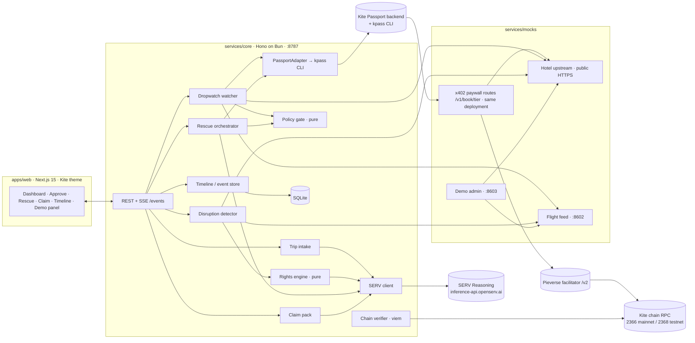
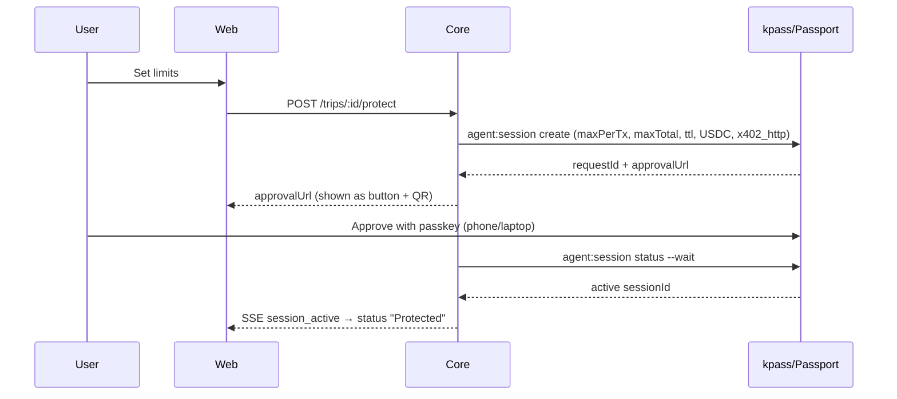
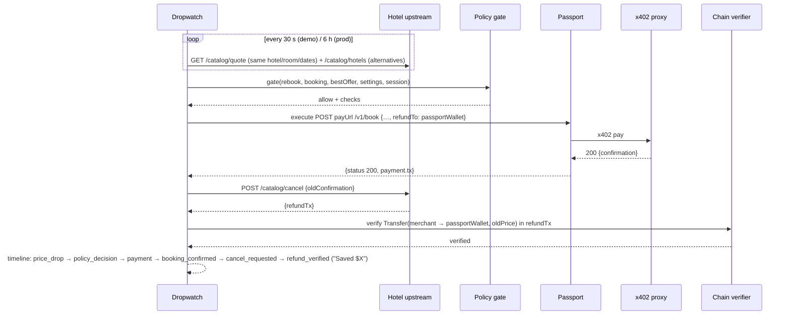
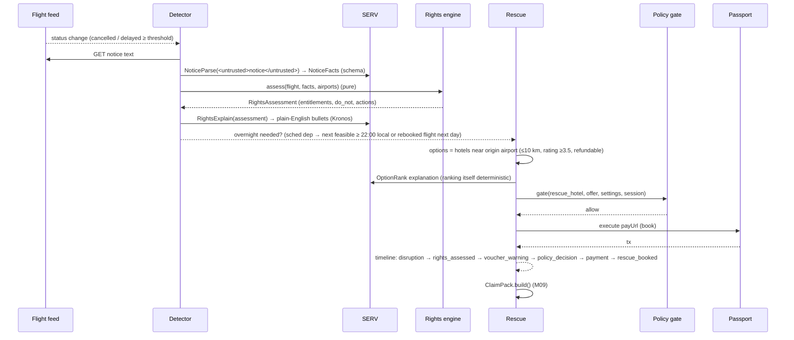

# Layover: Technical Design Document (v1.0, 2026-11-09)

## 1. Architecture


**Ports (local):** web 3000 · core 8787 · flight feed 8602 · demo admin 8603.
**Deployed publicly (required: Passport calls merchants from Kite's servers):** `layover-merchant` = hotel upstream + x402 paywall in **one Hono app** at `https://<MERCHANT_PUBLIC_URL>` (Railway, Fly or Render), with routes `/catalog/*` (free), `/v1/book/<tier>` (x402), `/healthz`, `/.well-known/x402`. Its admin routes (`/admin/*`) are protected by `ADMIN_TOKEN`. The flight feed may run locally or in the same deployment.

## 2. Repo tree (create exactly this)
```
layover/
  CLAUDE.md  package.json  pnpm-workspace.yaml  .env.example  README.md
  docs/ DECISIONS.md PROVEN.md build-pack/…
  apps/web/            Next.js app (see 04-UIUX-SPEC.md)
    app/(app)/{page.tsx, trips/[id]/page.tsx, trips/[id]/claim/page.tsx, approve/page.tsx, demo/page.tsx}
    components/{ui/*, trip/*, timeline/*, rescue/*}  lib/{api.ts, sse.ts, format.ts}  styles/theme.css
  services/core/
    src/index.ts                 Hono app, routes, SSE
    src/db.ts  src/migrations.sql
    src/serv/{client.ts, prompts/*.ts, schemas.ts}
    src/passport/{adapter.ts, kpass.ts, fake.ts, errors.ts}
    src/policy/gate.ts           PURE
    src/rights/{engine.ts, distance.ts}   PURE
    src/dropwatch/{watcher.ts, rebook.ts}
    src/disruption/{detector.ts, notice.ts}
    src/rescue/{orchestrator.ts, options.ts}
    src/claims/{pack.ts}
    src/timeline/{store.ts, events.ts}
    src/chain/{verify.ts}        viem: tx receipt + ERC20 Transfer checks
    src/demo/{runner.ts}
    test/**                      bun test
  services/mocks/
    src/hotel-upstream.ts  src/flight-feed.ts  src/demo-admin.ts  src/refund-sender.ts  src/paywall.ts
    data/{hotels.json, flights.json, airports.json}
  packages/shared/
    src/{schemas.ts, types.ts, money.ts}   rules/{eu261.json, uk261.json, us_dot.json, in_dgca.json}
```

## 3. Domain model (zod in `packages/shared/src/schemas.ts`, mirrored in `08-reference/schemas/`)
- **Money:** `{ amountMinor: bigint-as-string, currency: "USD"|"EUR"|"GBP"|"INR" }`. All internal math uses integer minor units. `money.ts` converts to and from token atomic units: USDC.e has 6 decimals, pieUSD 18. **Never use floats for money.**
- **Trip:** `{ id, travelerName, flights: Flight[], hotelBookings: HotelBooking[], settings: TripSettings, status: "draft"|"protected"|"completed" }`
- **Flight:** `{ id, carrier, number, from: IATA, to: IATA, schedDepUtc, schedArrUtc, bookingRef, airlineCountry, status: FlightStatus }`
- **FlightStatus:** `{ state: "scheduled"|"delayed"|"cancelled"|"departed"|"arrived", depDelayMin, arrDelayMin, noticeAtUtc?, reasonText?, reasonClass?: "weather"|"atc"|"security"|"technical"|"crew"|"strike"|"unknown" }`
- **HotelBooking:** `{ id, merchantId, hotelId, hotelName, rating, roomClass, checkIn, checkOut, price: Money, refundable: boolean, cancelDeadlineUtc, confirmation, paymentTx?, payer: Address, status: "active"|"cancelled"|"replaced" }`
- **TripSettings:** `{ autoRebook: boolean, minSaving: Money, autoRescue: boolean, emergencyBudget: Money, maxPerBooking: Money, maxHotelDistanceKm: 10, minRating: 3.5 }`
- **SessionRecord:** `{ id, requestId, purpose: "trip", maxPerTx: Money, maxTotal: Money, ttlUntilUtc, status: "requested"|"active"|"expired"|"exhausted", approvalUrl? }`
- **Offer:** `{ merchantId, hotelId, hotelName, rating, roomClass, distanceKm?, checkIn, checkOut, price: Money, refundable, cancelDeadlineUtc, payUrl, rateTier }`
- **PolicyDecision:** `{ allow: boolean, action: "rebook"|"rescue_hotel"|"rescue_ride", checks: {name, pass, detail}[], reasons: string[] }`
- **RightsAssessment:** see `00-context/03-passenger-rights-rules.md` §Engine output.
- **ClaimPack:** `{ id, tripId, flightId, airline, packs[], entitlements[], timeline[], receipts: {desc, amount, tx, explorerUrl}[], letter: { subject, body }, validated: boolean }`
- **TimelineEvent:** `{ id, tripId, atUtc, type, simulated: boolean, title, detail, data, links: {label,url}[] }`
  - `type` is one of: `trip_added | session_requested | session_active | price_checked | price_drop | policy_decision | payment | booking_confirmed | cancel_requested | refund_verified | flight_status | disruption | rights_assessed | rescue_booked | voucher_warning | claim_ready | error`

## 4. Storage (SQLite, `services/core/src/migrations.sql`)
Tables:
- `trips`, `flights`, `hotel_bookings`, `sessions`, `payments` (`id, tripId, bookingId, amountMinor, currency, tx, network, atUtc`), `refunds` (`id, bookingId, amountMinor, tx, verified, atUtc`)
- `rights_assessments` (`json`), `claims` (`json`), `events` (TimelineEvent), `serv_calls` (`id, step, model, tools, latencyMs, ok, errorClass, atUtc`, **no prompt text with personal data**), `kv`

Use WAL mode, and wrap every write in a short transaction.

## 5. Kite Passport integration (`services/core/src/passport/`)
```ts
interface PassportAdapter {
  status(): Promise<{ loggedIn: boolean; email?: string; wallet?: Address; network?: string }>;
  walletBalance(): Promise<{ address: Address; balances: { asset: string; amount: string }[] }>;
  requestSession(p: { taskSummary: string; maxPerTx: Money; maxTotal: Money; ttl: string; asset: "pieUSD" | "USDC" }): Promise<{ requestId: string; approvalUrl: string }>;
  awaitSession(requestId: string, timeoutMs: number): Promise<{ sessionId: string; status: "active"|"rejected"|"timeout" }>;
  execute(p: { url: string; method: "GET"|"POST"; headers?: Record<string,string>; body?: unknown }): Promise<{ status: number; body: unknown; payment?: { tx?: string; amount?: string; network?: string } }>;
}
```
- `kpass.ts` spawns `kpass … --output json --no-interactive` (Bun.spawn) with a 60 s timeout. It parses JSON, maps errors with `errors.ts`, and **never logs raw output containing tokens**.
- `fake.ts` (FakePassport) is in-memory. It enforces maxPerTx, maxTotal and TTL exactly like Kite and returns Kite's error codes. Every unit and integration test uses it.
- **Trip session strategy.** At onboarding, **one** session per trip:
  - `--task-summary "Layover trip <id>: hotel rebooks and disruption care for <traveler>, <dates>"`
  - `--max-amount-per-tx = maxPerBooking`
  - `--max-total-amount = emergencyBudget + maxPerBooking` (headroom so a rebook that's paid before the old booking is refunded doesn't hit the cap)
  - `--ttl` = until checkout + 24 h
  - `--assets pieUSD` in sandbox (`USDC` live) `--payment-approach x402_http`. The exact verb form (`agent:session` or `agent session`) comes from spike S9 via one argv table in `kpass.ts`.
  - **Sandbox:** run `kpass sandbox on` once (M00). The demo pays testnet pieUSD with real txs on testnet.kitescan.ai.
  - If S2 finds a constraints flag, scope the session to the mock merchant origins.
- **Error mapping:** `session_rule_exceeded`, `session_total_exceeded`, `session_endpoint_forbidden`, `payment_target_forbidden` and the rest become `PassportError{code, hint}`. The orchestrators emit a timeline `error` event plus a UI prompt "Approve a new session with …". **Never retry on the same session.**
- **Price scale:** default `PRICE_SCALE=100` (display $72.00, settle 0.72 pieUSD) to keep faucet needs small; label "Demo scale 1:100 · testnet".

### 5.3 Fallback ladder (if S8 shows Passport can't pay the deployed merchant)
This follows `00-context/05-feasibility-and-gaps.md §C`:
- **F1:** catalog PR plus a Kite allowlist request (`08-reference/kite-allowlist-request.md`).
- **F2:** a `DirectX402Payer` (EIP-3009 signer with a funded testnet agent key) implements the same `execute()` contract for hotel bookings, while Passport still pays real catalog data calls; the UI badge reads "direct x402 (testnet)".
- **F3:** a per-booking `wallet send` with a passkey step-up.

All three sit behind `PassportAdapter`, so the orchestrators don't change.

## 6. Mock merchants and feeds (`services/mocks/`)
### 6.1 Hotel upstream (:8601)
Free endpoints (no x402) are called directly by core:
- `GET /catalog/hotels?near=<IATA>&checkIn&checkOut` returns `Offer[]` from `data/hotels.json` with the current prices.
- `GET /catalog/quote?hotelId&roomClass&checkIn&checkOut` returns the current `Offer`.
- `POST /catalog/cancel { confirmation }` sets the booking to cancelled and **triggers the refund sender**. It returns `{ refundTx }` once submitted.

Paid endpoint (reached **only through a proxy**):
- `POST /v1/book { hotelId, roomClass, checkIn, checkOut, refundTo }`
  - It validates that the request's rate tier matches the current price tier. A mismatch returns 409 `price_changed`, so no settlement happens: the proxy settles only for upstream status < 400, as kite-x402-axum does. ⚠ Check this rule in kite-x402-hono; if it doesn't hold, check the price in a pre-flight `quote` call and accept the tiny risk.
  - On success it returns `{ confirmation, price, payer?: from-header, refundTo }`.

### 6.2 x402 paywall (route tiers in the deployed merchant). This replaces the multi-proxy idea.
- One Hono app uses `@x402/hono` `paymentMiddleware` with **one route per rate tier**: `POST /v1/book/58`, `/v1/book/64`, `/v1/book/72`, `/v1/book/80`, `/v1/book/96`, `/v1/book/110`. Each has `price = $tier/PRICE_SCALE`, `network = eip155:2368` (testnet) or `eip155:2366` (mainnet), and `payTo = MERCHANT_WALLET`, with the Pieverse facilitator `/v2`.
- Copy `kite.ts` network/asset constants from the official template (`gokite-ai/kite-x402-services/templates`). Keep the **verify → upstream handler → settle only if status < 400** order.
- `Offer.payUrl = ${MERCHANT_PUBLIC_URL}/v1/book/<tier>`.
- S3 confirms the route-config API. If `@x402/hono` lacks it, deploy the official typescript-express template behind a path router.
- kite-x402-hono (priority repo) is used for local tests (simulated facilitator via DI) and credited in the README.

#### (superseded) x402 proxies (:8401–8406)
- One `kite-x402-hono` instance per **rate tier**: 58, 64, 72, 80, 96 and 110 USD (prices × 1/PRICE_SCALE).
- (superseded by route tiers above; kept for reference only) Each would have had `PAY_TO`, `UPSTREAM_URL`, `KITE_NETWORK`, `PRICE_USD=tier/PRICE_SCALE`.
- `Offer.payUrl = http://localhost:84xx/v1/book`, and the matching tier is chosen by price.
- ⚠ S3: if `@x402/hono` supports a dynamic price callback, replace the tiers with one proxy.
- ✅ S7 resolved: Passport executes server-side, so the merchant **must** be on public HTTPS (see the ports note in §1).

### 6.3 Refund sender
- Uses viem with `MERCHANT_REFUND_KEY` (the same wallet as PAY_TO). On cancel it calls `transfer(refundTo, amount)` on the network's token (USDC.e on mainnet, pieUSD on testnet) and returns the tx hash.
- The merchant wallet needs KITE for gas: testnet via the faucet https://faucet.gokite.ai, mainnet via a small purchase. **[HUMAN]**

### 6.4 Flight feed (:8602)
- `GET /flights/:carrier-:number/:date` returns `FlightStatus`.
- `GET /flights/:id/notice` returns airline notice text (untrusted), e.g. "Due to operational reasons your flight LH761 has been cancelled. You have been rebooked on LH763 tomorrow 09:40 or may request a voucher."
- Optional (S4): if `ksearch services list --query flight` finds a paid flight-status service, Dropwatch/Detector can buy one real status check per poll through the same session, as a "real data via x402" badge.

### 6.5 Demo admin (:8603, only when `DEMO_MODE=1`)
- `POST /admin/price { hotelId, roomClass, newPrice }`
- `POST /admin/flight { id, state, depDelayMin, arrDelayMin, reasonClass, noticeText }`
- `POST /admin/reset`
- Each call also POSTs core `/internal/simulated` so the timeline marks the next event `simulated: true`.

## 7. Core API (`services/core`, JSON; auth is a single local `LAYOVER_LOCAL_TOKEN` header for the demo)
| Method | Path | Purpose |
|---|---|---|
| POST | `/trips/intake` `{ text }` | SERV TripIntake → a draft `Trip` plus `missing[]` |
| POST | `/trips` `{ trip }` | Save the trip |
| GET | `/trips/:id` | Trip, bookings, latest status, session, spend meter |
| POST | `/trips/:id/protect` `{ settings }` | Request the Kite session → `{ approvalUrl, requestId }` |
| GET | `/trips/:id/session` | Session status (polls `awaitSession` in the background) |
| POST | `/trips/:id/rebook/:bookingId/confirm` | Manual confirm when autoRebook is off |
| POST | `/trips/:id/rescue/confirm` `{ offerId }` | Manual confirm when autoRescue is off |
| GET | `/trips/:id/rights` | Latest `RightsAssessment` |
| GET | `/trips/:id/claim` | `ClaimPack` |
| GET | `/trips/:id/timeline` | `TimelineEvent[]` |
| GET | `/events?tripId=` | **SSE** stream of TimelineEvents and state changes |
| GET | `/health` | Core, SERV reachability, kpass status, mock health |

## 8. Flows
### 8.1 Protect a trip (one passkey approval)


### 8.2 Dropwatch rebook (Act 1)


Failure rules:
- **New booking fails:** keep the old booking and emit an `error` event.
- **Cancel fails:** keep both bookings and alert "Cancel manually before <deadline>". **Never cancel first.**
- **Refund not seen within 2 minutes:** emit `error` "Refund pending" and keep polling for 30 minutes.

### 8.3 Disruption rescue (Act 2)


## 9. Policy gate (`policy/gate.ts`, PURE, no I/O)
`gate(input): PolicyDecision`. The `allow` result requires **all** checks to pass:

**Common checks:**
- `session.status==="active"` and `now < ttl`
- `amount ≤ session.maxPerTx`
- `spentTotal + amount ≤ session.maxTotal`
- the offer currency matches the session currency (USD)
- `offer.payUrl` origin is in `ALLOWED_MERCHANT_ORIGINS`
- `amount > 0`

**Rebook checks:**
- `settings.autoRebook || manualConfirm`
- same `checkIn` and `checkOut`
- `roomClass rank ≥ booked`
- same hotel **or** (`rating ≥ booked.rating` and distance from the booked hotel ≤ 2 km)
- `offer.refundable` is true
- `now < booking.cancelDeadlineUtc − 2h` (time to cancel the old booking)
- `saving = old − new ≥ settings.minSaving`

**Rescue checks:**
- `settings.autoRescue || manualConfirm`
- the disruption requires an overnight stay
- `distanceKm ≤ maxHotelDistanceKm`
- `rating ≥ minRating`
- `offer.refundable` is true
- `amount ≤ maxPerBooking`
- check-in date equals the disruption night

Every check records `{name, pass, detail}` for the timeline. **The table tests in `03-TEST-PLAN.md` are the spec.**

## 10. Rights engine (`rights/engine.ts`, PURE)
- **Input:** `Flight`, `FlightStatus`, `NoticeFacts`, `airports.json`, rule packs, `now`.
- **Steps:**
  1. Decide which packs apply (EU/EEA departure, UK, US DOT for flights to, from or within the US, India for Indian carriers or domestic flights).
  2. Compute great-circle distance (haversine) and the band.
  3. Classify the event: cancellation with notice days, arrival delay, departure delay.
  4. Evaluate the rules into entitlements with confidence. An `extraordinary` cause removes compensation but keeps care.
  5. Build `do_not[]` and `actions[]` from rule metadata.
  6. Pick the best remedy.
- Amounts are always taken from pack data. VERIFY entries are output as `amountUpTo`.
- `rule_pack_versions` is included in every output.

## 11. SERV call graph (`serv/`)
All calls use the OpenAI SDK at `https://inference-api.openserv.ai/v1`, `response_format: json_schema strict`, and zod validation. A failure retries once with "Your previous output failed validation: <errors>", then fails visibly.

| Step | Model | Tools | Input | Output schema |
|---|---|---|---|---|
| `TripIntake` | `gpt-5.4-mini` | `serv_prompt_guard` | User text or pasted email in `<untrusted>` | `TripDraft` + `missing[]` |
| `NoticeParse` | `gpt-5.4-mini` | `serv_prompt_guard`, `serv_shadow_agent` (hint: "Every field must be literally supported by the notice; use 'unknown' otherwise") | Airline notice in `<untrusted>` | `NoticeFacts {state, newDepUtc?, offeredAlternatives[], offeredVoucher:boolean, reasonClass, noticeAtUtc?}` |
| `RightsExplain` | `gpt-5.4-mini-serv-kronos` | none | `RightsAssessment` JSON (trusted) | `Explanation {headline, bullets[≤5], doNot[≤3], disclaimer}`. It must not introduce amounts; a post-check ensures every number in the text appears in the assessment. |
| `OptionRank` | `gpt-5.4-nano` | none | Top 3 offers (already ranked by code) + context | `{ why: string[] }` (explanation only) |
| `ClaimDraft` | `claude-sonnet-5.5` (fallback `gpt-5.4-mini`) | `serv_shadow_agent` (hint: "No entitlement or amount may appear unless it is in the provided assessment; cite booking refs and receipts exactly") | ClaimPack data | `{ subject, body }` |

**System prompts:** full text in `05-modules/M02-serv-client.md`. Every request includes a system prompt (SERV requires one). Log only the step, model, latency and validity in `serv_calls`.

## 12. Chain verification (`chain/verify.ts`)
- viem `createPublicClient` on the RPC chosen by S1.
- `verifyPayment(tx)` checks the receipt status is 1 and records it.
- `verifyRefund(tx, {token, from: merchantWallet, to: passportWallet, amountAtomic})` decodes ERC-20 `Transfer` logs and requires an exact match.
- Explorer links: `https://kitescan.ai/tx/<hash>` or `https://testnet.kitescan.ai/tx/<hash>`.

## 13. Security and threat model
| Threat | Mitigation |
|---|---|
| Prompt injection via an airline notice, hotel description or pasted email | Untrusted text only goes in user messages wrapped in `<untrusted>`; `serv_prompt_guard`; schema-only outputs; **code decides money and entitlements**; explanations are post-checked for numbers |
| Overspend or double-spend | Kite session caps (rail), plus `policy.gate` (spent total, per-tx), plus an idempotency key per booking (`tripId:bookingId:offerId`) |
| Cancel-before-book race | The orchestrator order is enforced, with a state machine test |
| Refund not paid | On-chain verification, an alert, and kept evidence |
| Wrong legal advice | Rule packs with confidence and sources; VERIFY shown as "up to"; disclaimer; no auto-submission |
| Secret leakage | Keys only in `.env`; kpass login in `~/.kite-passport`; the browser never sees keys; logs redact |
| Demo triggers mistaken for real events | Every simulated event is labeled `simulated: true` and shows a "Simulated" chip |

## 14. Config (`.env.example` in `08-reference/`)
`SERV_API_KEY`, `SERV_MODEL_DEFAULT`, `KPASS_SANDBOX`, `MERCHANT_PUBLIC_URL`, `ADMIN_TOKEN`, `KITE_NETWORK`, `KITE_RPC_URL`, `KITE_TOKEN_ADDRESS`, `KITE_TOKEN_DECIMALS`, `PRICE_SCALE`, `MERCHANT_WALLET`, `MERCHANT_REFUND_KEY`, `FACILITATOR_URL`, `ALLOWED_MERCHANT_ORIGINS`, `DEMO_MODE`, `LAYOVER_LOCAL_TOKEN`, `KPASS_BIN`, `KPASS_BASE_URL` (optional)

## 15. Run and deploy
- `pnpm dev` starts mocks, proxies, core and web through a concurrently script.
- `pnpm test` runs bun tests in all packages.
- `pnpm demo:act1` and `pnpm demo:act2` are scripted runs for recording.
- **The merchant is deployed on Day 1** (Railway: `railway up` from `services/mocks`; or Fly/Render). Core and web run locally for the recording. Core calls the merchant's free `/catalog/*` routes, and Passport calls `/v1/book/*` from Kite's servers.
- Optional public demo: web on Vercel and core on Railway.
